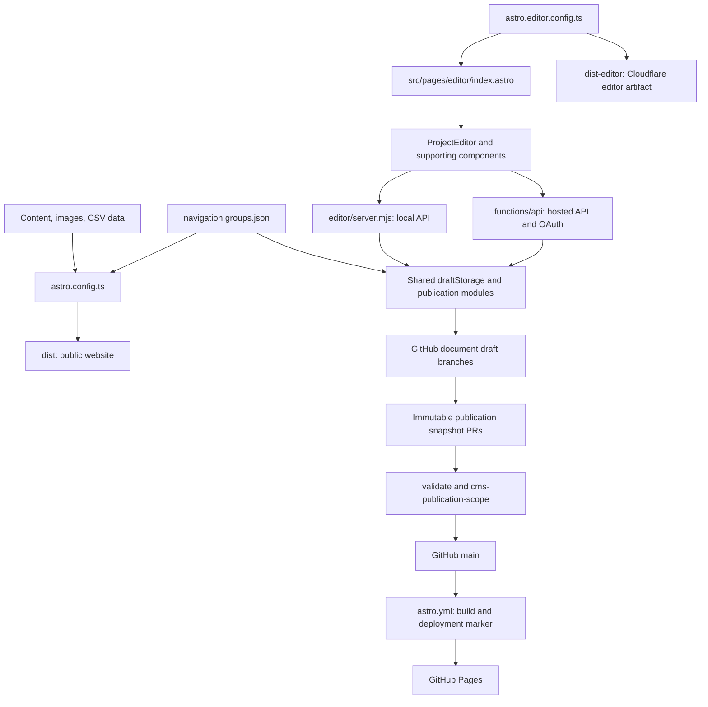

# Repository inventory

Updated November 23, 2026, against source revision `826c6b1`. This inventory
maps the repository after the cleanup and reliability reviews, separates completed
work from outstanding reviews, and records the validation performed along the way.
File counts describe tracked files at that revision, including this inventory;
generated output is excluded. Outstanding review candidates are not approved deletions.

The repository contains two build targets, a shared GitHub-backed editing and
publication system, and the earlier Decap CMS. Much of its file volume is content,
images, and tests. The editor and API reviews led to targeted reliability fixes,
regression tests, and documentation rather than broad refactoring. Filter behavior,
request-envelope limits, general documentation, and broader asset/dependency
cleanup remain outstanding; Decap and DataCitation reviews were deferred.

## Repository map

| Location | Tracked files | Responsibility |
| --- | ---: | --- |
| `src/content/` | 172 | Website content, schemas, and translations. `src/content/docs/` contains 169 Markdown/MDX documents and one gallery CSV. |
| `src/assets/` | 630 | Website image assets. |
| `src/components/` | 74 | 30 general site components, 39 editor UI/support files, and five editor block-rendering files. |
| `src/pages/` | 5 | Blog and Library indexes, gallery preview JSON, and editor entry page. |
| `src/plugins/`, `src/middleware/` | 8 | Markdown transforms and Starlight navigation/table-of-contents integration. |
| `src/styles/`, `src/utils/` | 8 | Shared styles; blog, library, gallery, and filter data helpers. |
| `src/tables/` | 30 | CSV data for tables, reports, and team information. |
| `editor/` | 106 | Shared editor backend/domain modules, tests, test helpers, deployment support files, and two guides. Includes 44 unit/API test files and 22 browser test files. |
| `functions/` | 1 | Cloudflare Pages API entry point, `api/[[path]].js`. |
| `public/` | 153 | Copied public assets: gallery thumbnails, documents, maps, Decap admin, redirects, and hosting files. |
| `scripts/` | 7 | Build/CI support, maintenance utilities, and profiling tools. |
| `tests/` | 5 | Production rendering, navigation, configuration, and editor artifact checks. |
| `.github/workflows/` | 3 | PR validation, publication eligibility, and public-site deployment. |
| `docs/` | 13 | Internal setup, editing, maintenance, design, and deployment guides. |
| `patches/` | 2 | One dependency compatibility patch and its explanation. |

There are 1,230 tracked files overall. Remaining root/source files provide build
configuration, navigation data, dependency manifests, ignore rules, and types.
`dist/`, `dist-editor/`, `.astro/`, `.wrangler/`, and `node_modules/` are ignored
local/generated directories; none is tracked. `.env.local` is also ignored.

## Application and publication flow

The diagram shows alternative local and hosted API paths. Public-site development
serves the editor at `/editor/`; the dedicated editor build serves it at `/` and
redirects legacy editor URLs. The dedicated build excludes public content,
gallery data, search indexes, and Decap. Cloudflare dashboard configuration is
documented in [deployment](cms-editor/deployment.md), rather than a root Wrangler
configuration. Live settings were not inspected for this inventory.

### Public website

- **Build and navigation:** `astro.config.ts` configures Astro/Starlight, React,
  icons, link validation, redirects, custom components, and Markdown transforms.
  `navigation.groups.json` holds navigation data; `navigation.config.ts` adds
  types and derived helpers. Publication preflight also uses the JSON data.
- **Content and presentation:** `src/content.config.ts` combines Starlight,
  blog, video, and older structured Program Update schemas. MDX imports site
  components directly, including historical layouts. Blog and Library listing
  pages use `src/utils/` and the filtering components.
- **Interactive features:** `DataCitation.tsx` implements the citation generator;
  `MapGallery.astro`, `FilterableGallery.tsx`, and `src/utils/mapGallery.ts` use
  submission CSV data and public thumbnails. `InstitutionsMap.astro` uses public
  map data.
- **External services:** citation autofill calls DataCite, Crossref, and the BTAA
  Geoportal. The institution map
  loads Leaflet from CDNs and external map tiles. External service availability
  is separate from a successful local build.
- **Route middleware:** `src/plugins/reverseDateSidebar.ts` and
  `removeTocOverview.ts` register the corresponding files in `src/middleware/`.
  These similarly named pairs are integration wrappers and implementations,
  rather than duplicate copies.

### Custom editor

| Responsibility | Main files |
| --- | --- |
| Application state, lists, document forms, images, save and publication actions | `src/components/editor/ProjectEditor.tsx` |
| Rich text, protected source, and supported blocks | `richTextEditor.ts`, `MdxMarkdown.ts`, `contentSyntax.ts`, `bodySegments.ts`, block views and MDX serializers in `src/components/editor/` |
| Preview, navigation, local recovery, pending uploads | `DocumentPreview.tsx`, `editorNavigation.ts`, `editorRecovery.ts`, `useEditorRecovery.ts`, `pendingImages.ts`, recovery dialogs |
| Publication confirmation and progress | `PublicationDialog.tsx`, `UnpublishDialog.tsx`, `PublicationStatus.tsx`, `LibraryPublicationProgress.tsx`, `publicationProgress.ts` |
| Public rendering of generated collection blocks | `src/components/editor-blocks/` |
| Content types, metadata, serialization and validation | `editor/content*.mjs`, `page.mjs`, `pageMetadata.mjs`, `blog.mjs`, `programUpdates.mjs`, `validateDocument.mjs` |
| GitHub storage, discovery, history and atomic creation | `editor/draftStorage.mjs`, `draftIdentity.mjs`, `draftCycles.mjs`, `contentDiscovery.mjs`, `gitComparison.mjs`, `blogStorage.mjs`, `articleCreation.mjs`, `imageAssets.mjs` |
| Immutable publication, policy and deployment verification | `editor/publication*.mjs`, `pullRequestEligibility.mjs`, `sourcePullRequest.mjs`, `unpublishGate.mjs`, `websiteStatus.mjs` |
| Local HTTP transport and token-based GitHub adapter | `editor/server.mjs`, `editor/github.mjs` |
| Hosted HTTP transport, OAuth, encrypted sessions and GitHub adapter | `functions/api/[[path]].js` |

Both APIs already reuse `createDraftStore` and the content serializers. Their
route dispatch and GitHub transport code remain separate. The completed
[API parity review](cms-editor/api-contract.md) documents their contracts, security
boundaries, and corrected input handling. No routing consolidation is recommended.

The editor stores saved work on per-document `cms/drafts/*` branches. Publication
uses `cms/publish/*` snapshots, `cms/publication-state/*` coordinator branches,
and lock tags. Browser recovery is separate from GitHub storage. These refs and
recovery records are operational state, not repository source clutter.

### Decap and compatibility support

- `public/admin/` contains Decap configuration, substantial UI customization,
  styles, and a GitHub publish-retry adapter. `npm run decap` starts its local
  proxy. Its configured OAuth service is external to this repository. The admin
  remains included in the public-site artifact. Its support/retirement review was
  explicitly deferred; no Decap changes were made.
- Ten content files reference `ProgramUpdateStructured`. Its renderer, schema,
  and table-of-contents support remain needed by checked-in content. The custom
  editor offers explicit conversion of older updates; it does not migrate all
  existing documents automatically.
- Existing MDX layouts and unsupported syntax remain protected by the editor.
  A component can still be needed by content even if new editor blocks do not
  generate it.
- `public/Map-Gallery-Update.html` and `public/Map-Gallery-Update/index.html`
  retain older gallery URLs as redirects. Their matching contents alone do not
  establish that either URL can be retired.
- `patches/starlight-fullview-mode+0.2.6.patch` fixes Zod 4 defaults and is applied
  by `postinstall`. [Patch documentation](../patches/README.md) records the removal
  condition and required checks.

## Tooling inventory

| Category | Files or commands | Classification |
| --- | --- | --- |
| PR validation | `validate.yml`, `cms-publication-scope.yml`, `scripts/check-cms-publication.mjs` | Active. Eligibility runs trusted base code and controls whether a CMS snapshot may skip browser tests. |
| Public deployment | `astro.yml`, `scripts/write-cms-deployment.mjs` | Active. Builds main, records rendered-document identities, rejects obsolete builds, and deploys Pages. |
| Draft-aware link validation | `scripts/draft-link-warnings.mjs` | Active import from `astro.config.ts`; used with publication route rules. |
| Gallery maintenance | `scripts/optimize-gallery.mjs`, `npm run optimize-gallery` | Documented utility using Sharp. |
| Performance investigation | `scripts/qualify-cms-free.mjs`, `profile-cms-reads.mjs` | Documented diagnostic tools. Qualification uses fixtures; profiling uses guarded live reads. Neither was run for this inventory. |
| CSV conversion | `scripts/csv_row_tables.py` | Standalone command-line utility. Confirm intended use and document or retire it. |
| Dependency management | `package.json`, `package-lock.json`, `.node-version` | npm with Node 24.13.1 pinned in `.node-version` and Volta; `engines` permits Node >=22.23.4. No alternative lockfile is tracked. |

Dependencies span Astro/Starlight, React/TipTap, Markdown/MDX parsing, CSV/maps,
and image processing. Test tooling includes Node's test runner, esbuild,
linkedom, Miniflare/workerd, and Chrome driven through the browser harness.
Package placement and actual usage remain a later dependency review; package
presence alone is not evidence of dead code.

## Documentation inventory

| Location | Intended purpose | Follow-up |
| --- | --- | --- |
| Root `README.md` | Project entry point, structure, commands, navigation | The stale header-component reference was removed. Still titled “Starlight Starter Kit: Basics”; emphasizes Decap and includes historical upgrade results. Navigation instructions should distinguish the JSON data from the TypeScript helpers. |
| `docs/README.md` | Internal documentation index | Keep as the main guide index; distinguish Decap from the custom editor. |
| `docs/LOCAL_SETUP.md` | Beginner setup and public-site development | Link to the custom editor setup after the site quick start. |
| `docs/CMS_USER_GUIDE.md` | Editorial instructions | Keep user tasks here; reconcile overlap with the application README. |
| `editor/README.md` | Editor application/development guide | Development/testing prerequisites and targeted commands are updated and link to the central validation reference. Broader duplication with the user/design guides remains an optional documentation cleanup. |
| `editor/local-blog-testing.md` | Guided local editing walkthrough | Check against the current draft workflow and link from the main local setup guide. |
| `docs/cms-editor/` | Design, deployment, validation and operational constraints | Validation now documents command scopes, isolation, TODO/skipped results, and CI/deployment boundaries; obsolete rollout wording was clarified. The API contract records corrected local/hosted boundaries and the deferred envelope-limit assessment. Preserve decisions and recovery constraints. |
| `docs/DECAP_LOCAL.md` | Earlier CMS setup | Mark its role clearly after deciding whether Decap remains supported. |
| Gallery and citation guides in `docs/` | Feature maintenance and data mappings | Retain and link from relevant feature code or the inventory. |
| `patches/README.md` | Dependency patch rationale | Retain beside the patch. |

## Completed cleanup and reliability work

| Area | Completed changes and review outcome |
| --- | --- |
| Historical files | Removed the three MKDocs-to-Astro migration scripts: `add-program-update-layout.mjs`, `convert-admonitions.mjs`, and `update-committees.mjs`. Removed the unused library and Program Update templates, `BaseLayout.astro`, `FooterWithBar.astro` and its commented configuration reference, and the unregistered custom `TableOfContents.astro`. Git history retains their source. |
| README correction | Removed the stale `HeaderWithCompactSearch.astro` reference from the root README. The broader README refresh remains outstanding. |
| Editor maintainability | Reviewed `ProjectEditor.tsx`; found no need for a broad pre-release refactor. Added rationale/invariant comments for asynchronous responses, document/session identity, pending images, list-cache invalidation, remount keys, saving/recovery, and publication consent. |
| Delayed image uploads | Reproduced a dismissed upload affecting another document or reopened editing session. Added picker-lifetime guards and browser regressions for Cancel, Escape, Close, navigation, reopening, and preservation of accepted images/unsaved edits. Image preparation creates no GitHub assets; unused pending images are excluded from draft saves. |
| Draft storage | Reviewed concurrency, retries, image ownership, and publication continuation. Fixed rejected immutable-read promises remaining cached in the long-lived local store. Added same-store retry/deduplication regressions for commit, tree, and blob reads. No storage refactor was needed. |
| Filter behavior | Added predictable browser fixtures for the actual Blog/Library pages, helpers, and filtering component, plus optional search-control coverage. Confirmed three defect categories represented by five TODO cases; production filtering was deliberately left unchanged. See the outstanding queue below. |
| API parity | Added paired local/hosted contracts and workerd coverage. Fixed local split-UTF-8 corruption, Origin-less OPTIONS handling, malformed base64 classification, malformed JSON/body/path handling, and unsupported-method consistency with `Allow` headers. Internal failures still return 500. Authentication, sessions, authorization, publication behavior, and separate handlers were preserved. See the [API contract](cms-editor/api-contract.md). |
| Commands and validation documentation | Made `test:editor:browser` sequential to match CI. Documented prerequisites, command purposes, targeted/full validation, intentional suite overlap, fixture isolation, skipped/TODO results, and deployment boundaries in the [editor README](../editor/README.md#development-and-testing) and [validation guide](cms-editor/validation.md#local-checks). All other npm commands, workflows, required checks, trusted-base validation, and deployment configuration were retained. |

The component/storage/API reviews do not establish a need to split large files.
Optional extractions can wait until a concrete change would benefit from them.
File length alone is not an outstanding cleanup task.

## Outstanding review and follow-up queue

| Priority or status | Remaining work | Approach and validation |
| --- | --- | --- |
| Next: confirmed filter defects | Checkbox changes drop active `q` searches on Blog and Library; changing a filter drops URL-specified oldest-first ordering; Blog filtering omits scalar/object authors accepted by the content schema. | Preserve active search/sort state when controls are absent and normalize supported author shapes. Convert the five TODO cases in `editor/filter-panel.browser.mjs` into ordinary passing regressions when fixes are approved. Retain independent expected result sets and page-isolation checks. |
| Next: browser reliability follow-up | An existing publication browser test intermittently timed out, then passed on repeat. Sequential execution reduces resource contention but does not establish the timeout's cause. | Reproduce and diagnose separately if it recurs; preserve the assertion and avoid simply increasing timeouts or suppressing failures. No production defect or root cause has been established. |
| Deferred assessment | Local request parsing retains a 28,000,000 JavaScript-code-unit cap; hosted parsing has no equivalent handler-level envelope guard. | Assess a suitable byte-based limit and platform constraints before harmonizing behavior. Preserve existing image/pending-asset bounds and authentication gates. The [API contract](cms-editor/api-contract.md#deferred-envelope-limit-assessment) documents the retained difference. |
| Documentation cleanup | Root README still contains starter/upgrade material and outdated navigation-editing guidance. Beginner setup and the local blog walkthrough could link more clearly to current editor instructions; editorial/technical guides still overlap. | Refresh the entry point and links, verify documented commands, and consolidate repeated prose around the existing user, design, API, and validation references. Do not reintroduce milestone reports or stale test counts as live release evidence. |
| Deferred by maintainer | Decap remains shipped with extensive customization and an external auth dependency. | Review only when requested: decide whether it is supported, a fallback, or ready for retirement. Trace its workflows and content compatibility before proposing removals. |
| Deferred by maintainer | `DataCitation.tsx` still combines metadata retrieval/mapping, citation formatting, exports, and form UI. | Review behavior and establish representative formatting/mapping/export checks before proposing extractions. No DataCitation production changes were made. |
| Optional filter/accessibility work | Production Blog/Library pages have no text-search input; the component supports one. Filter changes replace history entries rather than recording each selection. Result changes have no live announcement or total-result count. | Treat search UI, history policy, and result feedback as explicit product/accessibility decisions, separate from the confirmed defects. Complement browser keyboard/name checks with screen-reader and real-page layout review. |
| Optional tooling simplification | Deployment still detects a package manager despite npm-only configuration. The focused `test:editor:publication` shortcut remains a subset of `test:editor:render`. | Package-manager detection was intentionally left unchanged. If simplified later, preserve Pages site/base arguments, workflow identity, marker generation, required job IDs, trusted-base contracts, and deployment guards. Keep the publication shortcut unless removing it offers a concrete benefit; do not repeat it in full validation. |
| Later: utilities and broad reference audit | `scripts/csv_row_tables.py`, images, public documents, CSV data, layouts, dependencies, and styles still need a usage/purpose review. | Trace MDX, CSS, HTML, aliases, CSV rows, constructed paths, configuration, and public URLs before removal. Account for external inbound links and manual workflows. No broad asset/dependency deletion has been authorized by this inventory. |
| Later: bundles and diagnostics | Builds emit large-chunk and MDX module-directive warnings. Astro reports four existing hints. | Inspect bundle composition/browser-server boundaries and address diagnostics when useful. Preserve content-protection and artifact-hydration tests; do not split code solely to reduce line counts. |

## Validation baseline

The results below were recorded during the cleanup, not rerun for this inventory
update. The complete unit/API, browser, rendering, type, and build checks ran after
the API boundary corrections. The later npm/documentation change was verified
with the workflow/policy contracts and the updated npm browser command. Use the
[full pre-release sequence](cms-editor/validation.md#full-pre-release-validation)
at the exact merge/release candidate revision for fresh evidence.

All automated GitHub operations used in-memory mocks. No live editor repository
writes, publications, or deployments were performed. Checks used Node 24.13.1;
build/render commands ran sequentially so temporary source fixtures could not
contaminate the final production build.

| Check | Recorded result |
| --- | --- |
| `npm run astro -- sync` | Passed after API boundary corrections. |
| `npm run astro -- check` | Passed: 0 errors, 0 warnings, 4 existing hints. |
| `npm run test:editor` | Passed: 330 tests, no failures, skips, or TODOs, including workerd and API boundary regressions. |
| `npm run test:config` | Earlier inventory baseline passed; included in the documented full pre-release sequence. Not separately rerun during the API boundary correction. |
| `npm run test:editor:render` | Passed: rendering/security checks and production unpublish regressions. |
| `npm run build` followed by `npm run test:navigation` | Passed: 171 pages built, all internal links valid, two navigation tests passed. |
| `npm run test:editor:build` | Passed: dedicated artifact build and two artifact tests, including browser hydration. |
| `npm run test:editor:browser` | Updated sequential command completed with 93 passing tests, five known FilterPanel TODO cases, and no skips or unexpected failures on repeat. An earlier run had one publication-test timeout. |
| Workflow/policy contract tests | Eight tests passed for required CI coverage, deployment guards, and publication policy after the npm command change. |

Five TODO tests execute failing assertions without failing the command. The browser
result is therefore not a claim that filtering is defect-free. The earlier
302-unit/83-browser baseline described the initial inventory; it is superseded by
the expanded coverage above.

Astro's four hints identify unused `extractCover` and `cover` declarations in
`PageTitleWithMeta.astro`, deprecated `BeforeUnloadEvent.returnValue` in
`ProjectEditor.tsx`, and deprecated Zod `.url()` usage in `BlogSchema.ts`.
Both builds also emit Vite warnings about chunks larger than 500 kB and
module-level directives in MDX dependencies. These warnings did not fail the
builds or artifact tests and remain follow-up items.

This baseline covers local builds and mocked/isolated tests. It does not certify
live OAuth, repository protection, Cloudflare settings/capacity, external APIs,
or deployed page behavior. Follow the existing [validation guide](cms-editor/validation.md)
when a later cleanup affects those boundaries.
