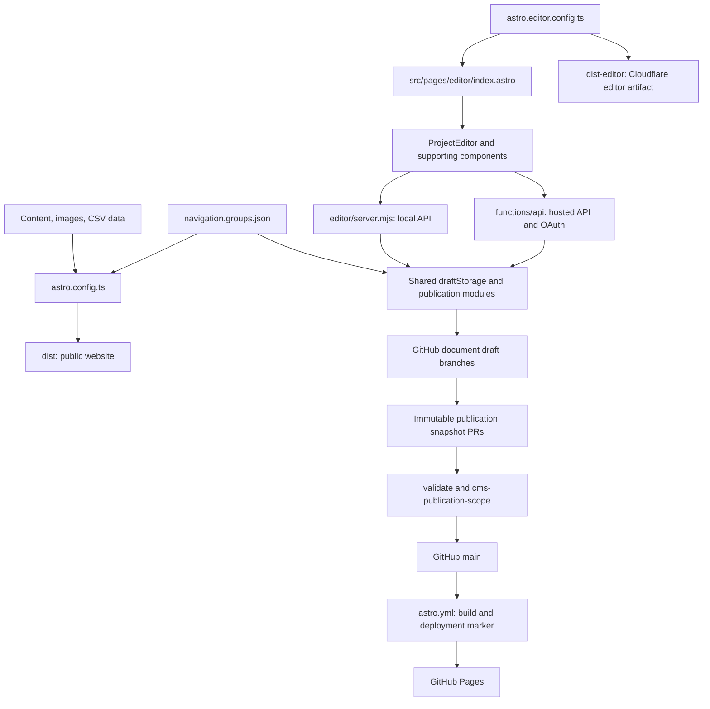

# Repository inventory

Reviewed November 23, 2026, against source revision `49c07a7`. This inventory
maps the website, editor, supporting tools, and documentation before cleanup.
File counts describe tracked files at that revision; they exclude this inventory
and generated output. Review candidates below are not approved deletions.

The repository contains two build targets, a shared GitHub-backed editing and
publication system, and the earlier Decap CMS. Much of its file volume is content,
images, and tests. The first cleanup opportunities are outdated instructions,
historical utilities, and apparently disconnected components. Changes to draft,
publication, and content-preservation code need more careful review.

## Repository map

| Location | Tracked files | Responsibility |
| --- | ---: | --- |
| `src/content/` | 173 | Website content, schemas, translations, and a Program Update template. `src/content/docs/` contains 169 Markdown/MDX documents and one gallery CSV. |
| `src/assets/` | 631 | 630 image assets and a library Markdown template. |
| `src/components/` | 77 | 33 general site components, 39 editor UI/support files, and five editor block-rendering files. |
| `src/pages/` | 5 | Blog and Library indexes, gallery preview JSON, provider demo, and editor entry page. |
| `src/plugins/`, `src/middleware/` | 8 | Markdown transforms and Starlight navigation/table-of-contents integration. |
| `src/styles/`, `src/utils/` | 8 | Shared styles; blog, library, gallery, and filter data helpers. |
| `src/tables/` | 30 | CSV data for tables, reports, and team information. |
| `editor/` | 104 | Shared editor backend/domain modules, tests, test helpers, deployment support files, and two guides. Includes 43 unit/API test files and 21 browser test files. |
| `functions/` | 1 | Cloudflare Pages API entry point, `api/[[path]].js`. |
| `public/` | 153 | Copied public assets: gallery thumbnails, documents, maps, Decap admin, redirects, and hosting files. |
| `scripts/` | 10 | Build/CI support, maintenance utilities, migrations, and profiling tools. |
| `tests/` | 5 | Production rendering, navigation, configuration, and editor artifact checks. |
| `.github/workflows/` | 3 | PR validation, publication eligibility, and public-site deployment. |
| `docs/` | 11 | Internal setup, editing, maintenance, design, and deployment guides. |
| `patches/` | 2 | One dependency compatibility patch and its explanation. |

There are 1,234 tracked files overall. Remaining root/source files provide build
configuration, navigation data, dependency manifests, ignore rules, and types.
`dist/`, `dist-editor/`, `.astro/`, `.wrangler/`, and `node_modules/` are ignored
local/generated directories; none is tracked. `.env.local` is also ignored.

## Application and publication flow

The diagram shows alternative local and hosted API paths. Public-site development
serves the editor at `/editor/`; the dedicated editor build serves it at `/` and
redirects legacy editor URLs. The dedicated build excludes public content,
gallery data, search indexes, and Decap. Cloudflare dashboard configuration is
documented in [deployment](cms-editor/deployment.md), rather than a root Wrangler
configuration. Live settings were not inspected for this inventory.

### Public website

- **Build and navigation:** `astro.config.ts` configures Astro/Starlight, React,
  icons, link validation, redirects, custom components, and Markdown transforms.
  `navigation.groups.json` holds navigation data; `navigation.config.ts` adds
  types and derived helpers. Publication preflight also uses the JSON data.
- **Content and presentation:** `src/content.config.ts` combines Starlight,
  blog, video, and older structured Program Update schemas. MDX imports site
  components directly, including historical layouts. Blog and Library listing
  pages use `src/utils/` and the filtering components.
- **Interactive features:** `DataCitation.tsx` implements the citation generator;
  `MapGallery.astro`, `FilterableGallery.tsx`, and `src/utils/mapGallery.ts` use
  submission CSV data and public thumbnails. `InstitutionsMap.astro` uses public
  map data. `ProviderSnapshot.tsx` powers the provider demo.
- **External services:** citation autofill calls DataCite, Crossref, and the BTAA
  Geoportal. The provider demo uses a development API URL. The institution map
  loads Leaflet from CDNs and external map tiles. External service availability
  is separate from a successful local build.
- **Route middleware:** `src/plugins/reverseDateSidebar.ts` and
  `removeTocOverview.ts` register the corresponding files in `src/middleware/`.
  These similarly named pairs are integration wrappers and implementations,
  rather than duplicate copies.

### Custom editor

| Responsibility | Main files |
| --- | --- |
| Application state, lists, document forms, images, save and publication actions | `src/components/editor/ProjectEditor.tsx` |
| Rich text, protected source, and supported blocks | `richTextEditor.ts`, `MdxMarkdown.ts`, `contentSyntax.ts`, `bodySegments.ts`, block views and MDX serializers in `src/components/editor/` |
| Preview, navigation, local recovery, pending uploads | `DocumentPreview.tsx`, `editorNavigation.ts`, `editorRecovery.ts`, `useEditorRecovery.ts`, `pendingImages.ts`, recovery dialogs |
| Publication confirmation and progress | `PublicationDialog.tsx`, `UnpublishDialog.tsx`, `PublicationStatus.tsx`, `LibraryPublicationProgress.tsx`, `publicationProgress.ts` |
| Public rendering of generated collection blocks | `src/components/editor-blocks/` |
| Content types, metadata, serialization and validation | `editor/content*.mjs`, `page.mjs`, `pageMetadata.mjs`, `blog.mjs`, `programUpdates.mjs`, `validateDocument.mjs` |
| GitHub storage, discovery, history and atomic creation | `editor/draftStorage.mjs`, `draftIdentity.mjs`, `draftCycles.mjs`, `contentDiscovery.mjs`, `gitComparison.mjs`, `blogStorage.mjs`, `articleCreation.mjs`, `imageAssets.mjs` |
| Immutable publication, policy and deployment verification | `editor/publication*.mjs`, `pullRequestEligibility.mjs`, `sourcePullRequest.mjs`, `unpublishGate.mjs`, `websiteStatus.mjs` |
| Local HTTP transport and token-based GitHub adapter | `editor/server.mjs`, `editor/github.mjs` |
| Hosted HTTP transport, OAuth, encrypted sessions and GitHub adapter | `functions/api/[[path]].js` |

Both APIs already reuse `createDraftStore` and the content serializers. Their
route dispatch and GitHub transport code remain separate. Review their contracts
before deciding whether further sharing would simplify maintenance.

The editor stores saved work on per-document `cms/drafts/*` branches. Publication
uses `cms/publish/*` snapshots, `cms/publication-state/*` coordinator branches,
and lock tags. Browser recovery is separate from GitHub storage. These refs and
recovery records are operational state, not repository source clutter.

### Decap and compatibility support

- `public/admin/` contains Decap configuration, substantial UI customization,
  styles, and a GitHub publish-retry adapter. `npm run decap` starts its local
  proxy. Its configured OAuth service is external to this repository. The admin
  remains included in the public-site artifact; current use needs confirmation.
- Ten content files reference `ProgramUpdateStructured`. Its renderer, schema,
  and table-of-contents support remain needed by checked-in content. The custom
  editor offers explicit conversion of older updates; it does not migrate all
  existing documents automatically.
- Existing MDX layouts and unsupported syntax remain protected by the editor.
  A component can still be needed by content even if new editor blocks do not
  generate it.
- `public/Map-Gallery-Update.html` and `public/Map-Gallery-Update/index.html`
  retain older gallery URLs as redirects. Their matching contents alone do not
  establish that either URL can be retired.
- `patches/starlight-fullview-mode+0.2.6.patch` fixes Zod 4 defaults and is applied
  by `postinstall`. [Patch documentation](../patches/README.md) records the removal
  condition and required checks.

## Tooling inventory

| Category | Files or commands | Classification |
| --- | --- | --- |
| PR validation | `validate.yml`, `cms-publication-scope.yml`, `scripts/check-cms-publication.mjs` | Active. Eligibility runs trusted base code and controls whether a CMS snapshot may skip browser tests. |
| Public deployment | `astro.yml`, `scripts/write-cms-deployment.mjs` | Active. Builds main, records rendered-document identities, rejects obsolete builds, and deploys Pages. |
| Draft-aware link validation | `scripts/draft-link-warnings.mjs` | Active import from `astro.config.ts`; used with publication route rules. |
| Gallery maintenance | `scripts/optimize-gallery.mjs`, `npm run optimize-gallery` | Documented utility using Sharp. |
| Performance investigation | `scripts/qualify-cms-free.mjs`, `profile-cms-reads.mjs` | Documented diagnostic tools. Qualification uses fixtures; profiling uses guarded live reads. Neither was run for this inventory. |
| Historical content transformations | `add-program-update-layout.mjs`, `convert-admonitions.mjs`, `update-committees.mjs` | Review candidates. All target `src/content/docs/blog`, which is absent at the reviewed revision, and rewrite files when executed. |
| CSV conversion | `scripts/csv_row_tables.py` | Standalone command-line utility. Confirm intended use and document or retire it. |
| Dependency management | `package.json`, `package-lock.json`, `.node-version` | npm with Node 24.13.1 pinned in `.node-version` and Volta; `engines` permits Node >=22.23.4. No alternative lockfile is tracked. |

Dependencies span Astro/Starlight, React/TipTap, Markdown/MDX parsing, CSV/maps,
and image processing. Test tooling includes Node's test runner, esbuild,
linkedom, Miniflare/workerd, and Chrome driven through the browser harness.
Package placement and actual usage remain a later dependency review; package
presence alone is not evidence of dead code.

## Documentation inventory

| Location | Intended purpose | Follow-up |
| --- | --- | --- |
| Root `README.md` | Project entry point, structure, commands, navigation | Still titled “Starlight Starter Kit: Basics”; emphasizes Decap, includes historical upgrade results, and names nonexistent `HeaderWithCompactSearch.astro`. Navigation instructions should distinguish the JSON data from the TypeScript helpers. |
| `docs/README.md` | Internal documentation index | Keep as the main guide index; distinguish Decap from the custom editor. |
| `docs/LOCAL_SETUP.md` | Beginner setup and public-site development | Link to the custom editor setup after the site quick start. |
| `docs/CMS_USER_GUIDE.md` | Editorial instructions | Keep user tasks here; reconcile overlap with the application README. |
| `editor/README.md` | Editor application/development guide | Mixes setup, detailed user behavior, technical constraints, and feature descriptions. Reduce duplication by linking to the user and design guides. |
| `editor/local-blog-testing.md` | Guided local editing walkthrough | Check against the current draft workflow and link from the main local setup guide. |
| `docs/cms-editor/` | Design, deployment, validation and operational constraints | Existing consolidation provides the main technical references. Preserve decisions and recovery constraints; reconcile any remaining rollout wording with the implementation. |
| `docs/DECAP_LOCAL.md` | Earlier CMS setup | Mark its role clearly after deciding whether Decap remains supported. |
| Gallery and citation guides in `docs/` | Feature maintenance and data mappings | Retain and link from relevant feature code or the inventory. |
| `patches/README.md` | Dependency patch rationale | Retain beside the patch. |

## Cleanup review queue

| Priority | Evidence and review target | Next action and validation |
| --- | --- | --- |
| First | README points to a missing header component; migration scripts target an absent directory. | Correct current entry-point documentation. Review each migration's history and remaining purpose before retiring it. Check documentation links and command references. |
| First | `BaseLayout.astro`, `src/assets/template-lib.md`, and `src/content/templates/program-update-template.mdx` have no name references found in tracked text. `FooterWithBar.astro` appears only in a commented config entry. The custom `TableOfContents.astro` has no active registration found. | Trace configuration, aliases, content imports, and manual workflows. Propose individual removals only after confirming purpose. Run type checking, builds and navigation checks for affected site components. |
| Next | Decap remains shipped and has extensive customization alongside the new editor. | Decide whether it is supported, a fallback, or ready for retirement. Inventory its workflows and external auth dependency before removing assets or packages. |
| Next | `ProjectEditor.tsx` is 1,215 lines; `draftStorage.mjs` is 546. Outside the editor, `DataCitation.tsx` is 1,935 and `FilterPanel.astro` is 648. | Review responsibilities and coupling. Extract only cohesive behavior that becomes easier to understand; line count alone does not justify refactoring. Use relevant feature checks and manual UI review. |
| Next | The local and hosted API handlers share domain modules but separately dispatch similar requests. | Compare routes, validation, errors, flags, and authorization differences. Preserve tests against both implementations before changing shared boundaries. |
| Next | Local browser npm command omits the sequential option used by CI and the validation guide. `test:editor:publication` repeats the unpublish fixture suite already included in `test:editor:render`. Deployment workflow includes package-manager detection despite a single npm lockfile. | Document command scope and prerequisites, then simplify where useful. Preserve required job names, trusted-base validation, and fixture isolation. |
| Later | Images, public documents, CSV data, layouts, dependencies, and styles span multiple features and historical content. | Trace references across MDX, CSS, HTML, aliases, CSV rows, constructed paths, and public URLs. Treat unreferenced candidates as provisional, especially files that may have external inbound links. |
| Later | Both builds report large chunks and module-directive warnings from MDX dependencies. The UI imports some shared `editor/` modules directly. | Inspect bundle composition and browser/server boundaries before changing imports or splitting code. Preserve protected-source and artifact hydration checks. |

## Validation baseline

Checks use the installed dependencies and pinned Node 24.13.1. No dependency
reinstallation, live publication, deployment, or GitHub mutation was performed.
The initial sandboxed unit run could not open loopback listeners; its rerun with
local-server access passed. Render fixtures and final production builds run
sequentially because fixtures temporarily add source documents.

| Check | Result on reviewed source |
| --- | --- |
| `npm run astro -- sync` | Passed. |
| `npm run astro -- check` | Passed: 0 errors, 0 warnings, 4 hints. |
| `npm run test:editor` | Passed: 302 tests, no failures or skips, including real workerd tests. |
| `npm run test:config` | Passed: one test. |
| `npm run test:editor:render` | Passed: two rendering tests and one production unpublish regression, no failures or skips. |
| `npm run build` followed by `npm run test:navigation` | Passed: 171 pages built, all internal links valid, two navigation tests passed. |
| `npm run test:editor:build` | Passed: dedicated artifact build and two artifact tests, including browser hydration. |
| `node --test --test-concurrency=1 editor/*.browser.mjs` | Passed: 83 tests, no failures or skips. |

Astro's four hints identify unused `extractCover` and `cover` declarations in
`PageTitleWithMeta.astro`, deprecated `BeforeUnloadEvent.returnValue` in
`ProjectEditor.tsx`, and deprecated Zod `.url()` usage in `BlogSchema.ts`.
Both builds also emit Vite warnings about chunks larger than 500 kB and
module-level directives in MDX dependencies. These warnings did not fail the
builds or artifact tests and remain follow-up items.

This baseline covers local builds and mocked/isolated tests. It does not certify
live OAuth, repository protection, Cloudflare settings/capacity, external APIs,
or deployed page behavior. Follow the existing [validation guide](cms-editor/validation.md)
when a later cleanup affects those boundaries.
